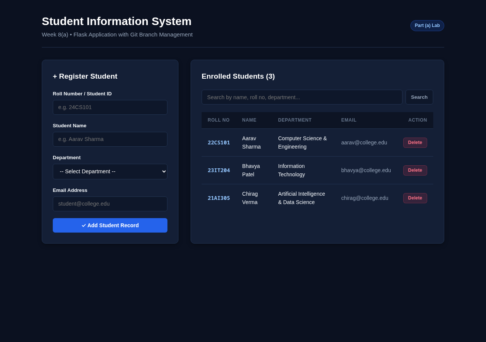
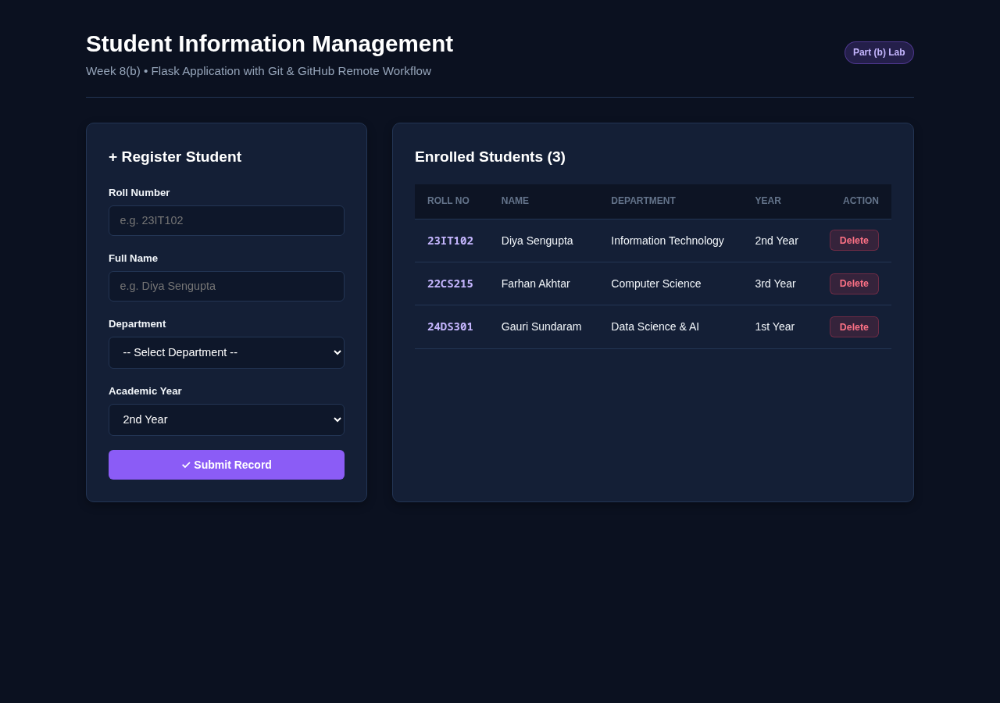
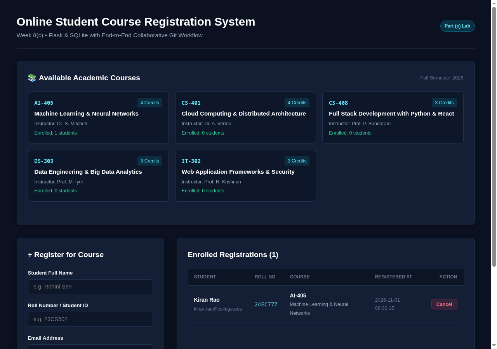

# Academic WAF &bull; Week-8 Flask Applications & Git/GitHub Workflows

An independently implemented laboratory suite for **Week-8** Web Application Frameworks (WAF) demonstrating **Python 3**, **Flask**, **SQLite3**, **HTML5/CSS3**, and **End-to-End Git & GitHub Workflows** including local branch management, remote repository management, and simulated collaborative multi-developer workflows.

---

## 📑 Table of Contents
1. [Overview of Week-8 Experiments](#-overview-of-week-8-experiments)
2. [Application Screenshots Gallery](#-application-screenshots-gallery)
3. [Technology Stack](#-technology-stack)
4. [Project Directory Structure](#-project-directory-structure)
5. [Setup & Installation](#-setup--installation)
6. [How to Run the Applications](#-how-to-run-the-applications)
7. [Detailed Experiment Specifications & Git Workflows](#-detailed-experiment-specifications--git-workflows)
   - [Part (a): Student Info & Git Branch Management](#part-a-student-information-system--git-branch-management)
   - [Part (b): Student Management & GitHub Remote Workflow](#part-b-student-management--github-remote-workflow)
   - [Part (c): Course Registration & Collaborative Git Workflow](#part-c-online-course-registration--collaborative-git-workflow)
8. [Automated Verification & Unit Testing](#-automated-verification--unit-testing)
9. [Terminal Evidence Log Files](#-terminal-evidence-log-files)
10. [References & Attributions](#-references--attributions)

---

## 🎯 Overview of Week-8 Experiments

| Experiment | Title | Description | Key Git / GitHub Workflow Demonstrated | Port |
|---|---|---|---|---|
| **Part (a)** | **Student Information System** | Flask app managing student records (Add, View, Delete) with client/server validation. | **Branch Management**: Created `feature-student-search` branch, implemented keyword search, committed, switched to `main`, merged (`--no-ff`), and deleted branch. | `5001` |
| **Part (b)** | **Student Management System** | Lightweight student tracking application with departmental organization. | **Remote Workflow**: Remote repository creation, staging (`git add`), committing (`git commit`), pushing (`git push`), modifying existing code, and re-pushing. | `5002` |
| **Part (c)** | **Online Course Registration** | Database-driven course registration system backed by SQLite. Validates course selection and prevents duplicates. | **Collaborative Workflow**: Feature branching & merging + cloning into a secondary workspace (`/tmp/waf_week8_collab_workspace`), contributor commit & push, and primary pull (`git pull origin main`). | `5003` |

---

## 📸 Application Screenshots Gallery

### 1. Part (a): Student Information System with Keyword Search
Searchable student management interface displaying enrolled students, add student form, and dynamic filter.


---

### 2. Part (b): Student Management with Audit Logging
Academic record intake interface showcasing department allocations, registration form, and server-side validation.


---

### 3. Part (c): Online Student Course Registration System (SQLite)
Course catalog grid showing credits, instructors, real-time enrollment counters, registration intake, and cancellation actions.


---

## 🛠️ Technology Stack

- **Python 3 (3.10+)**: Core backend runtime.
- **Flask (3.1+)**: WSGI routing framework.
- **SQLite3**: Relational database engine for course registrations.
- **Jinja2**: HTML templating engine.
- **HTML5 & Modern CSS3**: Dark navy responsive design system.
- **Git & GitHub CLI (`gh`)**: Version control, branch lifecycles, and remote synchronization.
- **Pytest & Unittest**: Automated regression tests.

---

## 📂 Project Directory Structure

```text
WAF-Week8-Assignments/
│
├── requirements.txt            # Project dependencies (Flask, pytest)
├── README.md                   # Comprehensive documentation & Git evidence report
├── .gitignore                  # Git exclusions for venv, caches, and DB files
├── run_all.py                  # Master launcher script running all 3 apps concurrently
│
├── part_a/                     # Week 8(a): Student Info & Branching
│   ├── app.py                  # Flask application (Port 5001)
│   ├── static/css/style.css    # Responsive dark navy styling
│   └── templates/
│       └── index.html          # Searchable student directory & registration
│
├── part_b/                     # Week 8(b): Student Management & GitHub Workflow
│   ├── app.py                  # Flask application with audit logging (Port 5002)
│   ├── static/css/style.css    # Responsive styling
│   └── templates/
│       └── index.html          # Student intake & enrollment table
│
├── part_c/                     # Week 8(c): Course Registration & Collaborative Git
│   ├── app.py                  # Flask application (Port 5003)
│   ├── database.py             # SQLite helper methods & schema setup
│   ├── static/css/style.css    # Course card grid & responsive tables
│   └── templates/
│       └── index.html          # Course offerings & student registration pass
│
├── evidence/                   # Actual recorded terminal outputs from Git executions
│   ├── week8a/
│   │   └── git_branch_workflow.txt        # Branch creation, feature commit, & merge
│   ├── week8b/
│   │   └── github_remote_workflow.txt     # Remote add, push, modify, & re-push
│   └── week8c/
│       └── collaborative_git_workflow.txt # Multi-developer clone, push, pull, & graph
│
├── screenshots/                # Captured high-resolution application screenshots
│   ├── week8a_student_info.png
│   ├── week8b_student_management.png
│   └── week8c_course_registration.png
│
└── tests/                      # Automated test suite
    └── test_week8.py           # Unit tests covering all 3 parts
```

---

## ⚙️ Setup & Installation

### 1. Virtual Environment
```bash
cd ~/college_work/WAF_lab/WAF-Week8-Assignments/
python3 -m venv .venv
source .venv/bin/activate
```

### 2. Install Dependencies
```bash
pip install --upgrade pip
pip install -r requirements.txt
```

---

## 🚀 How to Run the Applications

### Option 1: Run All Three Apps Simultaneously
```bash
python run_all.py
```
This spawns all three applications concurrently:
- Part (a): `http://127.0.0.1:5001/`
- Part (b): `http://127.0.0.1:5002/`
- Part (c): `http://127.0.0.1:5003/`

### Option 2: Run Individual Apps
- **Part (a)**: `python part_a/app.py` &rarr; [http://127.0.0.1:5001/](http://127.0.0.1:5001/)
- **Part (b)**: `python part_b/app.py` &rarr; [http://127.0.0.1:5002/](http://127.0.0.1:5002/)
- **Part (c)**: `python part_c/app.py` &rarr; [http://127.0.0.1:5003/](http://127.0.0.1:5003/)

---

## 🔍 Detailed Experiment Specifications & Git Workflows

### Part (a): Student Information System & Git Branch Management

#### Demonstrated Workflow:
1. Initialize repository and make initial commit on `main`.
2. Create and switch to a new feature branch:
   ```bash
   git checkout -b feature-student-search
   ```
3. Implement student keyword search and filter logic in `part_a/app.py` and `part_a/templates/index.html`.
4. Stage and commit on the branch:
   ```bash
   git add part_a/app.py part_a/templates/index.html
   git commit -m "feat(student-search): Implement student keyword search and filter feature"
   ```
5. Switch back to `main`:
   ```bash
   git checkout main
   ```
6. Merge the feature branch:
   ```bash
   git merge feature-student-search --no-ff -m "Merge branch 'feature-student-search' into main"
   ```
7. Delete the feature branch:
   ```bash
   git branch -d feature-student-search
   ```
8. Verify commit log: `git log --graph --oneline -n 5`.

---

### Part (b): Student Management & GitHub Remote Workflow

#### Demonstrated Workflow:
1. Create public GitHub remote repository `WAF-Week8-Assignments`.
2. Link local repository to remote origin:
   ```bash
   git remote add origin git@github.com:CH-JASWANTH-KUMAR/WAF-Week8-Assignments.git
   ```
3. Check status and push initial commits:
   ```bash
   git push -u origin main
   ```
4. Modify an existing file (`part_b/app.py`) to add request audit logging.
5. Check file diff:
   ```bash
   git diff part_b/app.py
   ```
6. Stage and commit the modification:
   ```bash
   git add part_b/app.py
   git commit -m "feat(part-b): Add request audit logging hook and enhanced status handling"
   ```
7. Push modification to GitHub:
   ```bash
   git push origin main
   ```

---

### Part (c): Online Course Registration & Collaborative Git Workflow

#### Demonstrated Workflow:
1. Feature Branching: Created branch `feature-course-limit`, implemented maximum enrollment validation in `part_c/app.py`, committed, merged into `main`, and pushed to origin.
2. Simulated Second Contributor Workspace:
   - Cloned remote repository into a second workspace `/tmp/waf_week8_collab_workspace`.
   - Simulated a collaborator identity (`git config user.name "Simulated Collaborator"`).
   - Contributed an aggregate registration helper `get_total_enrollments_count` to `part_c/database.py`.
   - Staged, committed, and pushed to `origin main`.
3. Primary Workspace Synchronization:
   - Fetched updates: `git fetch origin`.
   - Pulled and fast-forward merged collaborator changes: `git pull origin main`.
4. Complete Commit Graph Verification:
   ```bash
   git log --graph --oneline --all -n 10
   ```
   **Actual Commit Graph Output:**
   ```text
   * 9cb7554 collab(courses): Add enrollment count aggregate helper function
   *   eb3e226 Merge branch 'feature-course-limit' into main
   |\  
   | * 02679a2 feat(courses): Add maximum enrollment limit validation on feature branch
   |/  
   * d7763f1 feat(part-b): Add request audit logging hook and enhanced status handling
   *   3ecf6f3 Merge branch 'feature-student-search' into main
   |\  
   | * e06f4ae feat(student-search): Implement student keyword search and filter feature
   |/  
   * 53c2363 feat: Initial commit of Week 8 WAF laboratory assignments
   ```

---

## 🧪 Automated Verification & Unit Testing

Run the test suite across all three parts:
```bash
pytest -v tests/test_week8.py
```
or
```bash
python -m unittest tests/test_week8.py
```

### Test Results:
```text
============================= test session starts ==============================
collected 4 items                                                              

tests/test_week8.py::TestWeek8Assignments::test_part_a_add_and_delete PASSED [ 25%]
tests/test_week8.py::TestWeek8Assignments::test_part_a_get PASSED [ 50%]
tests/test_week8.py::TestWeek8Assignments::test_part_b_get_and_add PASSED [ 75%]
tests/test_week8.py::TestWeek8Assignments::test_part_c_course_registration PASSED [100%]

============================== 4 passed in 0.14s ===============================
```

---

## 📄 Terminal Evidence Log Files

Actual terminal outputs produced during each Git demonstration are saved in the `evidence/` directory:
- `evidence/week8a/git_branch_workflow.txt` &bull; Branch creation, feature commit, merge & deletion.
- `evidence/week8b/github_remote_workflow.txt` &bull; Remote creation, status, staging, committing & pushing.
- `evidence/week8c/collaborative_git_workflow.txt` &bull; Two-workspace collaborative push, pull & commit graph.

---

## 📚 References & Attributions

- Week-8 Reference Repository: [https://github.com/CherukuriPavanKumar/waf-assn-8.git](https://github.com/CherukuriPavanKumar/waf-assn-8.git) (Used as an educational problem statement reference).
- Git Documentation: [https://git-scm.com/doc](https://git-scm.com/doc)
- Flask Documentation: [https://flask.palletsprojects.com/](https://flask.palletsprojects.com/)
- SQLite3 Documentation: [https://www.sqlite.org/docs.html](https://www.sqlite.org/docs.html)
